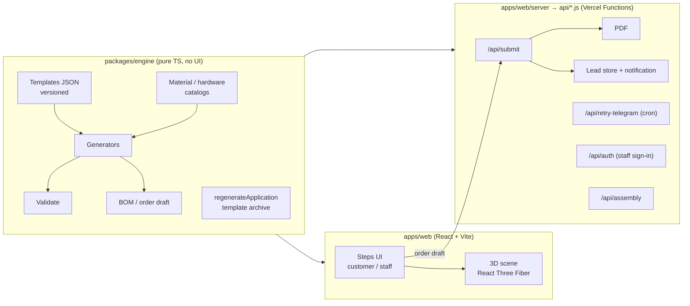

# Dafna Configurator

A self-service 3D furniture configurator for the touchscreen kiosks in Dafna (EMAN) furniture
showrooms. A customer picks a product, changes its size, colours, interior and hardware, sees
it update in real time in 3D, and sends the finished design to the sales team as an
application, with a PDF of the result.

Products: **wardrobe** (shkaf), **office pedestal** (ofis tumbasi) and **desk** (stol).
The UI is in Uzbek and Russian.

## Screenshots

> Media goes in `docs/media/` (not added yet).

| Customer mode                                                                             | Staff mode                                                                                        |
| ----------------------------------------------------------------------------------------- | ------------------------------------------------------------------------------------------------- |
| `docs/media/customer-flow.gif`: start screen → 4 steps → 360° presentation → contact form | `docs/media/staff-mode.png`: every parameter, engine issues, unconfirmed values, order-draft JSON |
| `docs/media/customer-review.png`: review with dimensions                                  | `docs/media/staff-pdf.png`: application PDF                                                       |

## What it does

- **Parametric engine.** Each product is a versioned JSON template (parameters, limits,
  standard sizes, rules) plus a generator. The engine turns parameters into panels with their
  real dimensions, material, edge banding and grain. A UI-free validator flags
  construction and ergonomic problems (GOST and EN 527 / EN 14073 heights and sizes).
- **Live 3D.** React Three Fiber renders the generated panels, with a dimension overlay, a
  smart camera and a full-screen 360° presentation.
- **Two modes.** _Customer mode_ is a simple 4-step flow in plain language, using centimetres
  and standard sizes only. _Staff mode_ (unlocked by a staff sign-in) shows every
  parameter, technical warnings and assumptions that production has not yet confirmed.
- **Reproducible applications.** An application stores only its parameters and template
  version. Templates are never edited in place: a change is always a new version, and archived
  versions stay loadable. So any old application regenerates the exact same order draft,
  covered by fixture tests (ADR-002, ADR-011).
- **Submission pipeline.** Serverless functions validate the draft, assign an idempotent
  application ID, store the lead, notify the sales channel and render a PDF. A cron job
  retries failed notifications.
- **Live prices.** The price is computed on the server from a price list a manager keeps on
  `/manager` (staff sign-in, ADR-024): sheet prices of the boards, edge band, hardware, labour, assembly and
  the profit %. Customers only ever receive the final number (ADR-016).
- **Production hand-off.** A bill of materials (boards, edge banding, hardware) and a
  cutting-list export.
- **Kiosk details.** On-screen keyboard, idle timeout with session reset, light and dark themes
  with an automated WCAG contrast test.

## Architecture



| Path                | What                                                                           |
| ------------------- | ------------------------------------------------------------------------------ |
| `packages/engine`   | Product engine: templates, catalogs, generators, validation, BOM, regeneration |
| `apps/web/src`      | Kiosk UI: start screen, steps, 3D viewer, presentation, contact flow, i18n     |
| `apps/web/server`   | Serverless handlers (TypeScript) and their tests                               |
| `apps/web/api`      | Generated, self-contained function bundles (see below)                         |
| `docs/adr`          | Architecture decision records                                                  |
| `scripts/check.ps1` | Quality gate                                                                   |

The server code is bundled by `apps/web/scripts/build-api.mjs` (esbuild) into
`apps/web/api/*.js`. **The bundles are committed on purpose:** Vercel runs them as plain JS and
never compiles the workspace engine package. `server/bundle.test.ts` fails when a bundle is
out of date, so run `node scripts/build-api.mjs` (in `apps/web`) after changing the server,
engine or i18n.

## Stack

- **Language:** TypeScript (strict), pnpm workspaces
- **UI:** React 19, Vite, three.js with React Three Fiber and drei, lucide icons, a custom
  token-based design system
- **Server:** Vercel Functions (Node), esbuild bundles, pdf-lib, Google Sheets REST API and
  Telegram Bot API through small adapters (no SDKs)
- **Quality:** Vitest with Testing Library and jsdom, ESLint, Prettier, `tsc --noEmit`

## Getting started

Requires Node.js >= 20 and pnpm 12 (pinned via `packageManager`; run `corepack enable`).

```powershell
pnpm install
pnpm dev
```

- Customer mode: http://localhost:5173/
- Staff mode: http://localhost:5173/?mode=staff
- Manager price page: http://localhost:5173/manager (dev sign-in `admin`, password
  `DEV_ADMIN_PASSWORD`, default `admin`; dev only)

The server functions read their configuration from environment variables only. Nothing secret
is in the repository or in the client bundle.

## Quality gate

```powershell
pnpm test        # vitest (engine + web + server)
pnpm lint        # eslint + prettier --check
pnpm typecheck   # tsc --noEmit in every package
pnpm build       # engine build + web build

# Full gate (lint + typecheck + test + build), non-zero exit on any failure:
powershell -NoProfile -ExecutionPolicy Bypass -File scripts/check.ps1 -Quiet
```

The tests cover geometry (every panel inside the product's box, for each layout and size),
template migrations, deep-equal regeneration of stored applications, the submission pipeline
with fake adapters, UI flows and colour contrast.
